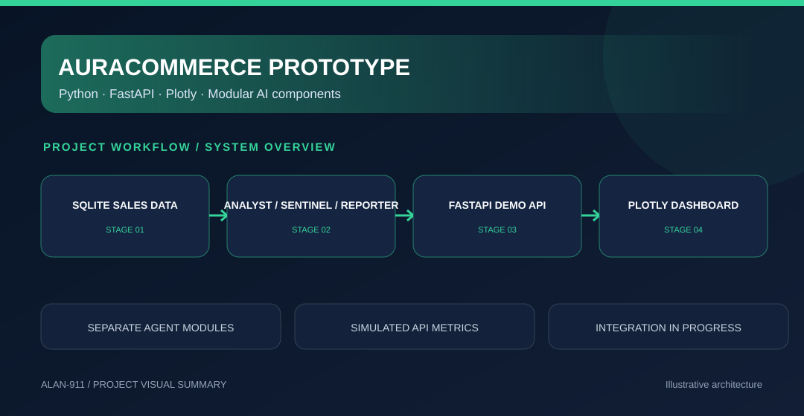

# AuraCommerce — AI-Assisted Business Intelligence Prototype

**E-commerce analytics · FastAPI · Python · SQLite · Plotly.js · Optional LLM analysis**

[Dashboard demo](https://enterprise-agent-framework.vercel.app) · [Analyst](agents/analyst.py) · [Sentinel](agents/sentinel.py) · [Reporter](agents/reporter.py)

## Prototype overview



*Conceptual overview. The individual agent modules are not yet connected to the simulated hosted dashboard.*

## Overview

AuraCommerce explores an e-commerce monitoring workflow for automotive parts sales: collect sales metrics, detect business anomalies, summarize findings and present operational information in a dashboard.

The repository contains **three separately implemented analysis modules** plus a **FastAPI dashboard prototype**. The current local and Vercel applications show simulated demonstration metrics; they **do not yet execute the full Analyst → Sentinel → Reporter pipeline end to end**. This distinction is intentional in this README.

## Implemented components

| Component | Implementation | Status |
| --- | --- | --- |
| Analyst | [agents/analyst.py](agents/analyst.py) queries SQLite order data and calculates sales summaries with pandas | Implemented as a standalone module |
| Sentinel | [agents/sentinel.py](agents/sentinel.py) evaluates summary data using rules or an optional OpenAI API call | Implemented as a standalone module |
| Reporter | [agents/reporter.py](agents/reporter.py) formats metrics and anomaly text | Implemented as a standalone module |
| Local dashboard API | [main.py](main.py) exposes `/api/state` and `/api/export_report` | Uses synthetic in-memory state |
| Hosted dashboard API | [api/index.py](api/index.py) and [vercel.json](vercel.json) | Uses simulated time-varying values |
| Dashboard UI | [ui/](ui/) renders interactive Plotly charts with API polling | Implemented |
| Monitoring | [monitoring/prometheus.yml](monitoring/prometheus.yml) | Configuration only; no demonstrated `/metrics` endpoint |

## Intended analytics pipeline

```text
SQLite order data
   → Analyst: revenue, order counts, top products
   → Sentinel: anomaly evaluation (rule-based or optional LLM)
   → Reporter: structured business insight
   → API → dashboard
```

**Current gap:** The running backend does not call these agents. The displayed sentiment, advertising return and timing values are illustrative data, **not measurements from an actual connected commerce system**. The selected timeframe currently scales demo values rather than querying different historical ranges.

## Run the dashboard locally

```bash
git clone https://github.com/Alan-911/enterprise-agent-framework.git
cd enterprise-agent-framework
python -m venv .venv
# Activate your virtual environment
pip install fastapi uvicorn fpdf2 pandas openai python-dotenv
python main.py
```

Then open:

- Dashboard: http://localhost:8000/
- State API: http://localhost:8000/api/state
- PDF report: http://localhost:8000/api/export_report

The local UI runs without an OpenAI key because its current data source is simulated. The standalone Sentinel module uses `OPENAI_API_KEY` only when explicitly invoked. The published `requirements.txt` is intended for the hosted API and is not sufficient to run all experimental agent modules locally.

## Design strengths

- Separation of analysis, anomaly evaluation and reporting concerns in Python modules.
- Optional model-based interpretation with a rule-based path for demonstrations.
- FastAPI endpoints, interactive charts and PDF export.
- A concrete business-operations use case that can be extended with real data and measurable outcomes.

## Engineering roadmap

1. Connect the SQLite Analyst, Sentinel and Reporter pipeline to a single FastAPI service.
2. Replace synthetic dashboard metrics with actual computed values.
3. Use one backend architecture for local and hosted deployments.
4. Add automated unit, integration and API tests.
5. Validate and constrain model outputs; add timeouts, retries and auditable failures.
6. Add an actual metrics endpoint before advertising Prometheus observability.
7. Measure performance before publishing latency, availability or “production-ready” claims.
8. Evaluate LangGraph/Kubernetes only if the implementation needs their capabilities.

## Repository map

```text
agents/             Analyst, Sentinel, Reporter modules
api/index.py        Hosted simulated-data API
main.py             Local simulated-data API
data/               SQLite sample data and generator
ui/                 Plotly dashboard
monitoring/         Prometheus scrape configuration
vercel.json         Hosted routing configuration
```

## Project status

**Prototype / integration in progress.** Not yet a production multi-agent orchestration framework, and no LangGraph, Kubernetes or pluggable vector database implementation is demonstrated in this codebase.

**Maintainer:** Yves Alain Iragena · [Portfolio](https://alan-911.github.io/my-portfolio/)
